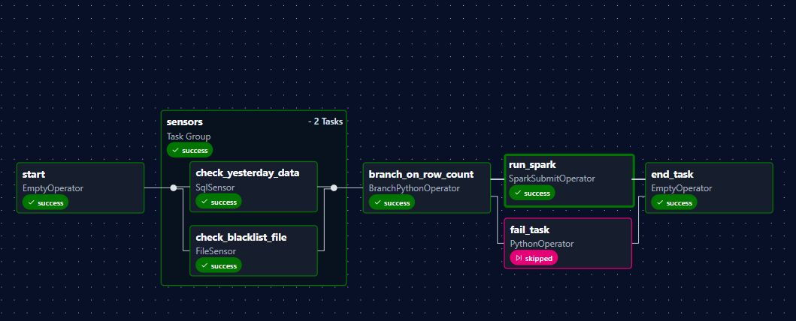
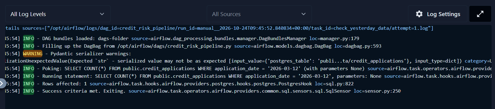
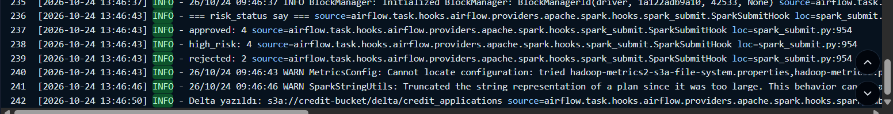
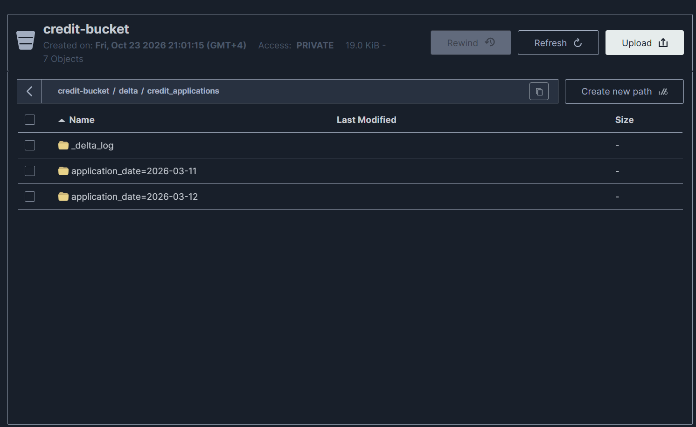
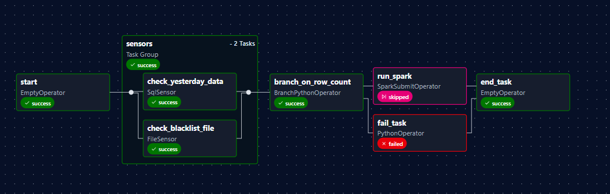
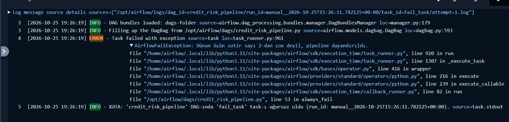

# Credit Risk Pipeline: Airflow 3.1 + Spark + Delta Lake + MinIO + PostgreSQL

Kredit müraciətlərini Postgres-dən oxuyan, `blacklist.csv` ilə yoxlayan və hər müraciətə `risk_status` (`approved` / `high_risk` / `rejected`) verən Airflow pipeline-ı. Nəticə MinIO-da Delta formatında, `application_date` üzrə partition edilərək saxlanır.

## Axın

```
start → [check_yesterday_data, check_blacklist_file] → branch_on_row_count → run_spark  ┐
                                                                           → fail_task ┴→ end_task
```

| Task | Operator | Nə edir |
|---|---|---|
| `start` | `EmptyOperator` | Boş başlanğıc |
| `check_yesterday_data` | `SqlSensor` | Dünən (`logical_date - 1 gün`) üçün Postgres-də data var? |
| `check_blacklist_file` | `FileSensor` | `blacklist.csv` yerindədir? (`fs_default` Connection) |
| `branch_on_row_count` | `BranchPythonOperator` | Dünənin sətir sayı 2-dən çoxdursa `run_spark`, yoxsa `fail_task` |
| `run_spark` | `SparkSubmitOperator` | Spark job-u işə salır (`spark_default` Connection) |
| `fail_task` | `PythonOperator` | `AirflowFailException` ilə qəsdən xəta verir |
| `end_task` | `EmptyOperator` | `trigger_rule="all_done"` |

İki sensor `reschedule` modunda işləyir: 10 saniyədən bir yoxlayır, 60 saniyədən sonra timeout verir. Sensorlar `sensors` TaskGroup-undadır (bonus). "Dünən" hesabı `get_yesterday()` funksiyasında aparılır və hər yerdə yalnız o istifadə olunur.

## Layihə strukturu

```
credit-risk-lab/
├── airflow/
│   ├── dags/credit_risk_pipeline.py
│   ├── spark_jobs/credit_risk_job.py
│   ├── data/blacklist.csv
│   └── config/  plugins/  logs/  files/
├── sql/
│   ├── 01_create_credit_db.sql
│   └── 02_credit_applications.sql
├── docs/images/                # ekran görüntüləri
├── Dockerfile
├── docker-compose.yaml
├── requirements.txt
└── .env.example
```

## Servislər və portlar

| Servis | Ünvan |
|---|---|
| Airflow UI | http://localhost:8090 (`admin` / `admin`, yalnız lokal lab üçün) |
| PostgreSQL | `localhost:5437` |
| MinIO API | `localhost:9010` |
| MinIO Console | http://localhost:9011 |

## İşə salma

```bash
cp .env.example .env        # CHANGE_ME yerlərini doldur
docker compose build
docker compose up -d
docker compose exec -T postgres psql -U airflow -d postgres -f /sql/01_create_credit_db.sql
docker compose exec -T postgres psql -U airflow -d credit_db -f /sql/02_credit_applications.sql
```

Sonra:
1. MinIO Console-da `credit-bucket` yarat.
2. Airflow UI-də Connection-ları və Variable-ı əlavə et (aşağıdakı cədvəl).
3. `credit_risk_pipeline` DAG-ını aktiv et və Trigger et.

### Connection və Variable

| Ad | Tip | Parametrlər |
|---|---|---|
| `pg_conn_id` | Postgres | host `postgres`, port `5432`, database `credit_db`, login/parol `.env`-dəki `POSTGRES_USER` / `POSTGRES_PASSWORD` |
| `spark_default` | Spark | host `local[*]`; Extra JSON-da `null` dəyərlər olmamalıdır (`rest-port` və `rest-scheme` üçün dəyər yaz) |
| `fs_default` | File (path) | Extra: `{"path": "/"}` |

Variable `credit_pipeline_config`:
```json
{"postgres_table": "public.credit_applications", "s3_path": "s3a://credit-bucket/delta/credit_applications"}
```

Cədvəl adı və S3 yolu DAG-da yalnız bu Variable-dan gəlir.

## Spark job

`credit_risk_job.py` bunları edir:
1. `credit_applications` cədvəlini JDBC ilə Postgres-dən oxuyur. Login və parol `PG_USER` və `PG_PASSWORD` mühit dəyişənlərindən gəlir.
2. `blacklist.csv` faylını oxuyur və `customer_id` üzrə `left join` edir.
3. `risk_status` sütununu yuxarıdan aşağı, ilk uyğun qayda ilə təyin edir:
   - `rejected`: müştəri blacklist-dədir
   - `high_risk`: `requested_amount > monthly_income * 12` **və ya** `existing_debt > monthly_income * 0.7` **və ya** `employment_years < 1` **və ya** `age < 21`
   - `approved`: qalan hamısı
4. Hər statusun sayını çap edir.
5. Nəticəni `application_date` üzrə partition edib, `overwrite` rejimində Delta formatında MinIO-ya yazır.

Postgres login və parolu `run_spark` task-ında `pg_conn_id` Connection-dan mühit dəyişəni kimi Spark-a ötürülür. Kodda parol yoxdur.

### Gözlənilən nəticə

| Müştəri | Status | Səbəb |
|---|---|---|
| C101, C106, C109, C110 | `approved` | heç bir risk əlaməti yoxdur |
| C102 | `high_risk` | `50000 > 3000 * 12` |
| C103 | `high_risk` | `1800 > 2000 * 0.7` |
| C104 | `high_risk` | staj `0.5 < 1` |
| C105 | `high_risk` | yaş `19 < 21` |
| C107, C108 | `rejected` | blacklist-dədir |

C108 həm blacklist-dədir, həm də `high_risk` şərtlərinə uyğundur. Qaydalar yuxarıdan aşağı yoxlandığı üçün `rejected` qalır. Cəmi: **4 approved, 4 high_risk, 2 rejected**.

## Testlər

"Dünən" = `logical_date - 1 gün`. Data iki tarixdədir: `2026-03-12` (8 sətir) və `2026-03-11` (2 sətir).

| Test | Logical date | Dünən | Sətir sayı | Nəticə |
|---|---|---|---|---|
| 1 (uğurlu) | `2026-03-13` | `2026-03-12` | 8 | `run_spark` işləyir |
| 2 (xəta) | `2026-03-12` | `2026-03-11` | 2 | `fail_task` xəta verir |

### Test 1: uğurlu axın

Sətir sayı 2-dən çoxdur, branch `run_spark`-ı seçir, `fail_task` skipped olur və `end_task` işləyir.



`check_yesterday_data` sensoru Variable-dan gələn cədvəl adı ilə dünənin tarixini (`2026-03-12`) yoxlayır və success olur:



`run_spark` logunda statusların sayı və Delta yazılışı görünür (4 approved, 4 high_risk, 2 rejected):



MinIO-da `credit-bucket/delta/credit_applications` içində `_delta_log` və `application_date` üzrə iki partition qovluğu yaranıb:



### Test 2: xəta axını

Dünən üçün cəmi 2 sətir var, `2 > 2` yalandır. Branch `fail_task`-ı seçir, `run_spark` skipped olur, `fail_task` failed olur. `end_task` isə yenə işləyir:



`fail_task` logunda `AirflowFailException` mesajı və callback-in yazdığı qısa bildiriş (hansı DAG, hansı task) görünür:



## Niyə `end_task` üçün `all_done`?

Branch səbəbindən `run_spark` və `fail_task`-dan biri həmişə `skipped` olur, `fail_task` isə bilərəkdən `failed` olur. Defolt `all_success` ilə `end_task` yalnız bütün upstream task-lar uğurlu olanda işləyərdi, yəni Test 2-də heç vaxt işə düşməzdi. `all_done` upstream task-ların vəziyyətindən (success, failed, skipped) asılı olmayaraq hamısı bitəndə işləyir, ona görə pipeline-ın sonu hər ssenaridə təmiz bağlanır. Test 2 screenshot-unda bu görünür: `fail_task` failed, `run_spark` skipped, amma `end_task` success.

Qeyd: `end_task` yeganə son (leaf) task olduğundan, `fail_task` uğursuz olsa belə, DAG run-ın ümumi statusu `success` görünə bilər.

## Təhlükəsizlik

- `.env` Git-ə getmir, `.env.example` yalnız şablondur.
- Postgres parolu kodda yazılmır, Connection-dan mühit dəyişəni kimi ötürülür.
- Cədvəl adı və S3 yolu koda yazılmır, `credit_pipeline_config` Variable-ından gəlir.
- `admin` / `admin` yalnız lokal təcrübə mühiti üçündür.